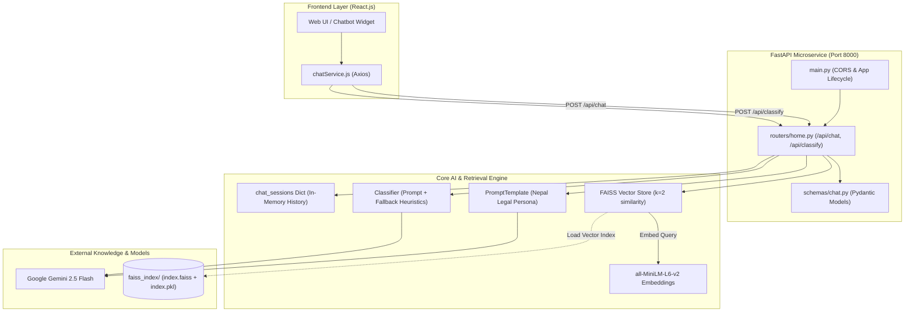
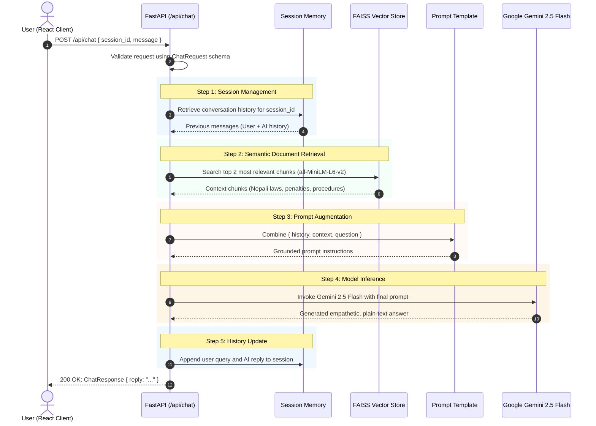
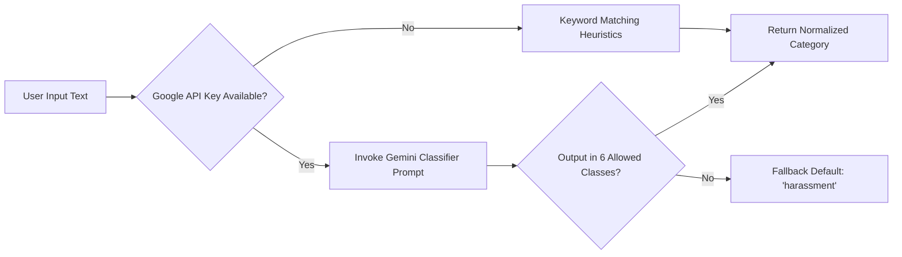

# 🇳🇵 Nepal Legal Chatbot & Incident Classifier Backend

FastAPI microservice powering the **AI-driven Legal Guidance Chatbot** and **Incident Classification System** for the *Anonymous Incident Reporting & Evidence Vault* platform (Janakpur Hackathon).

Built with **FastAPI**, **LangChain**, **FAISS Vector Store**, **Sentence Transformers**, and **Google Gemini 2.5 Flash**.

---

## 📑 Table of Contents

- [Overview](#-overview)
- [Architecture & Workflow](#-architecture--workflow)
  - [High-Level Architecture](#1-high-level-architecture)
  - [Chatbot RAG Pipeline Flow](#2-chatbot-rag-pipeline-flow)
  - [Incident Classification Pipeline](#3-incident-classification-pipeline)
- [How the Chatbot Works (Deep Dive)](#-how-the-chatbot-works-deep-dive)
  - [1. In-Memory Session Memory](#1-in-memory-session-memory)
  - [2. Semantic Search & Legal Knowledge Base (FAISS)](#2-semantic-search--legal-knowledge-base-faiss)
  - [3. Prompt Engineering & Empathetic Persona](#3-prompt-engineering--empathetic-persona)
  - [4. LLM Generation (Gemini 2.5 Flash)](#4-llm-generation-gemini-25-flash)
  - [5. Graceful Fallback System](#5-graceful-fallback-system)
- [Directory Structure](#-directory-structure)
- [API Reference](#-api-reference)
  - [Health Check](#get-)
  - [Chat with Legal Assistant](#post-apichat)
  - [Classify Incident](#post-apiclassify)
- [Setup & Installation](#-setup--installation)
  - [Prerequisites](#prerequisites)
  - [Installation Steps](#installation-steps)
  - [Environment Variables](#environment-variables)
  - [Running the Server](#running-the-server)
- [Knowledge Base & Vector Store Generation](#-knowledge-base--vector-store-generation)
- [Tech Stack](#-tech-stack)

---

## 🌟 Overview

The **Nepal Legal Chatbot** is designed to provide 24/7, confidential, empathetic, and legally grounded assistance for victims of gender-based violence (GBV), harassment, domestic abuse, cybercrimes, and discrimination in Nepal.

Key capabilities:
1. **Retrieval-Augmented Generation (RAG)**: Retrieves relevant sections of Nepali law and the Constitution of Nepal to answer user queries accurately without hallucinations.
2. **Multi-turn Memory**: Maintains conversational context across chat sessions using unique session identifiers.
3. **Empathetic & Culturally Aware Tone**: Specifically tuned to acknowledge the user's emotional state while providing clear legal recourse in plain English.
4. **Legal Category Classification**: Automatically classifies reported complaints into 6 standard legal categories for incident routing and NGO dashboard analytics.

---

## 🏗️ Architecture & Workflow

### 1. High-Level Architecture



---

### 2. Chatbot RAG Pipeline Flow

The diagram below details what happens when a user sends a legal question through the chat interface:



---

### 3. Incident Classification Pipeline

When an incident report or message needs legal categorization:



**Supported Categories:**
1. `harassment`
2. `domestic_violence`
3. `sexual_violence`
4. `cyber_violence`
5. `stalking_and_threats`
6. `gender_discrimination`

---

## 🔍 How the Chatbot Works (Deep Dive)

The chatbot core is located in `core/chat.py` and implements a full **Retrieval-Augmented Generation (RAG)** pipeline:

### 1. In-Memory Session Memory
- Each interaction passes a `session_id`.
- The server maintains a dictionary `chat_sessions = { session_id: [{"role": "...", "message": "..."}] }`.
- Prior to inference, `get_history_text(session_id)` formats the past conversation into standard dialogue lines to provide multi-turn conversation memory.

### 2. Semantic Search & Legal Knowledge Base (FAISS)
- **Embedding Model**: `sentence-transformers/all-MiniLM-L6-v2` produces compact 384-dimensional dense vectors.
- **Index**: Pre-indexed FAISS database stored on disk at `core/faiss_index/` (`index.faiss` and `index.pkl`).
- **Retriever**: Performs similarity search with `k=2` nearest neighbors, extracting the most relevant sections of Nepali law, constitutional articles, and legal precedents.

### 3. Prompt Engineering & Empathetic Persona
The prompt template in `core/chat.py` enforces specific domain constraints:
- **Nepali Jurisdiction**: Strict adherence to Nepali statutes, rights, cultural context, and legal terminology.
- **Empathetic Acknowledgment**: Acknowledges feelings of distress or emotion before delivering structured legal guidance.
- **Formatting Constraints**: Plain English responses without markdown syntax, bold text, or raw newline symbols to keep messages accessible and easily renderable across any chat UI.
- **Fallback Reasoning**: In cases where retrieved documents lack explicit details, the LLM provides guidance based on general Nepali legal practice rather than failing abruptly.

### 4. LLM Generation (Gemini 2.5 Flash)
- Interfaced via `langchain_google_genai.ChatGoogleGenerativeAI`.
- Uses Google's `gemini-2.5-flash` model for high-speed, cost-efficient, and accurate conversational inference.

### 5. Graceful Fallback System
- If the `GOOGLE_API_KEY` is not configured or an external network error occurs, the API doesn't crash.
- It returns an informative placeholder message advising system administrators to configure credentials, while still maintaining session history integrity.
- The classifier (`core/classifier.py`) includes keyword-based heuristics (e.g. searching for terms like "husband", "cyber", "stalk", "assault") if the LLM is unreachable.

---

## 📁 Directory Structure

```
backend_fastapi/
├── core/
│   ├── chat.py                # Main RAG pipeline, memory manager & Gemini LLM
│   ├── classifier.py          # Incident legal category classifier
│   ├── chat1.py               # Reference / legacy implementation
│   └── faiss_index/           # Pre-built FAISS vector store
│       ├── index.faiss        # Vector embeddings index
│       └── index.pkl          # Document chunk metadata
├── routers/
│   └── home.py                # API route definitions (/chat, /classify)
├── schemas/
│   └── chat.py                # Pydantic schemas (ChatRequest, ChatResponse, etc.)
├── .env.example               # Template for environment variables
├── .gitignore                 # Files excluded from git tracking
├── main.py                    # FastAPI entrypoint & CORS configuration
├── requirements.txt           # Python dependencies
└── README.md                  # This file
```

---

## 📡 API Reference

Base URL: `http://localhost:8000`

### `GET /`
Health check endpoint.

**Response (200 OK):**
```json
{
  "status": "Chatbot running"
}
```

---

### `POST /api/chat`
Submit a message to the AI legal assistant.

**Headers:**
- `Content-Type: application/json`

**Request Body (`ChatRequest`):**
```json
{
  "session_id": "session_1729400000_abc123",
  "message": "What legal actions can I take if someone is harassing me online in Nepal?"
}
```

**Response Body (`ChatResponse`):**
```json
{
  "reply": "I am truly sorry you are going through this. Under Nepal's Electronic Transactions Act, online harassment, cyberbullying, and sending threatening or obscene material are punishable offenses. You can file a formal complaint with the Cyber Bureau of the Nepal Police in Kathmandu or at your nearest police station with screenshots and digital evidence."
}
```

---

### `POST /api/classify`
Categorize an incident description into a standard legal category.

**Headers:**
- `Content-Type: application/json`

**Request Body (`ClassifyRequest`):**
```json
{
  "text": "My family is constantly demanding dowry and physically threatening me."
}
```

**Response Body (`ClassifyResponse`):**
```json
{
  "reply": "domestic_violence"
}
```

---

## 🚀 Setup & Installation

### Prerequisites
- **Python**: Version 3.10, 3.11, or 3.12
- **pip** package manager
- **Google Gemini API Key** (from [Google AI Studio](https://aistudio.google.com/))

### Installation Steps

1. **Navigate to the backend directory:**
   ```bash
   cd Janakpur_Hackathon/backend_fastapi
   ```

2. **Create and activate a virtual environment:**
   ```bash
   # On Linux/macOS
   python3 -m venv .venv
   source .venv/bin/activate

   # On Windows (cmd)
   .venv\Scripts\activate.bat
   ```

3. **Install dependencies:**
   ```bash
   pip install -r requirements.txt
   ```

### Environment Variables

Copy the example `.env.example` file to create your `.env` file:
```bash
cp .env.example .env
```

Edit `.env` and add your Google Gemini API key:
```env
GOOGLE_API_KEY=your_gemini_api_key_here
```

### Running the Server

Start the FastAPI application using Uvicorn:
```bash
python main.py
```
Or run directly with uvicorn:
```bash
uvicorn main:app --host 0.0.0.0 --port 8000 --reload
```

The server will be available at:
- **API Base**: `http://localhost:8000`
- **Interactive Swagger Docs**: `http://localhost:8000/docs`
- **Alternative ReDoc UI**: `http://localhost:8000/redoc`

---

## 🧠 Knowledge Base & Vector Store Generation

The vector index located at `core/faiss_index/` was generated from legal documents using the scripts in `Notebook/`:
- **Source Documents**:
  - `fine_tune_data.pdf`: Procedural guidelines and specific laws regarding gender violence in Nepal.
  - `constitution_nowater.pdf`: The Constitution of Nepal (fundamental rights, equality, remedies).
- **Chunking Strategy**: `RecursiveCharacterTextSplitter` with `chunk_size=1000` and `chunk_overlap=200`.
- **Vector Space**: Embedded via `sentence-transformers/all-MiniLM-L6-v2` and saved locally using `FAISS.save_local()`.

---

## 🛠️ Tech Stack

| Component | Library / Service | Description |
|---|---|---|
| **Web Framework** | FastAPI (`0.124.0`) | High-performance asynchronous REST API |
| **ASGI Server** | Uvicorn (`0.38.0`) | Lightning-fast ASGI server implementation |
| **LLM Orchestration** | LangChain (`1.1.2`) | RAG chains, prompt templates, and retriever interface |
| **Large Language Model** | Google Gemini 2.5 Flash | Conversational reasoning and legal response generation |
| **Embeddings** | Sentence-Transformers (`all-MiniLM-L6-v2`) | 384-dimensional semantic text embeddings |
| **Vector Store** | FAISS CPU (`1.13.1`) | High-speed dense vector similarity retrieval |
| **Validation** | Pydantic (`2.12.5`) | Robust request/response schema parsing |
